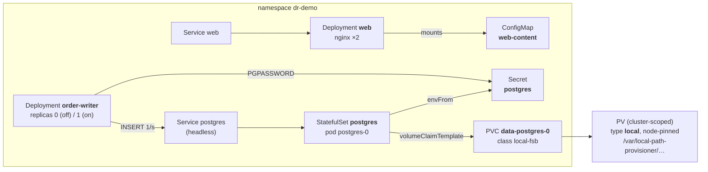
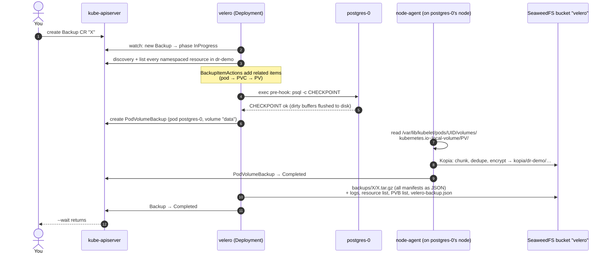
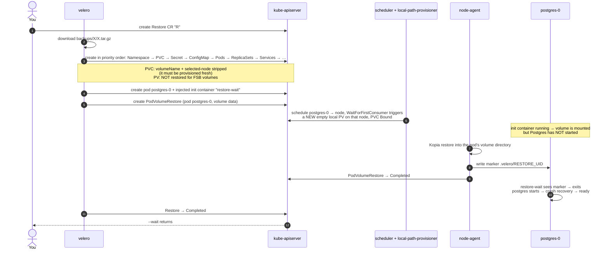
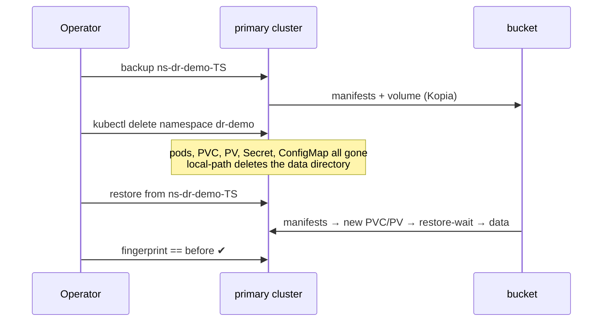
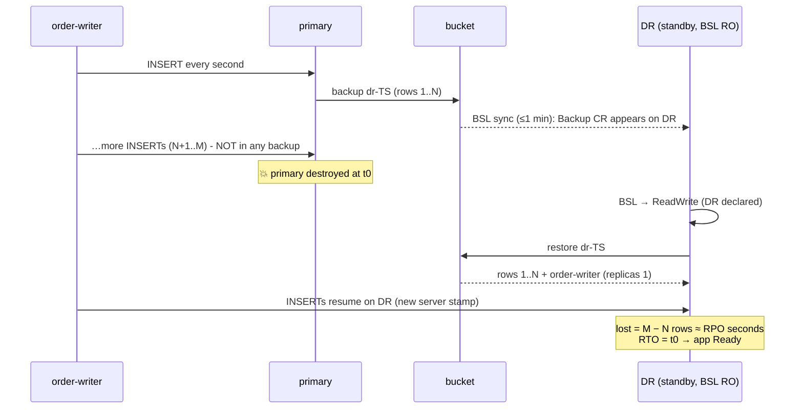
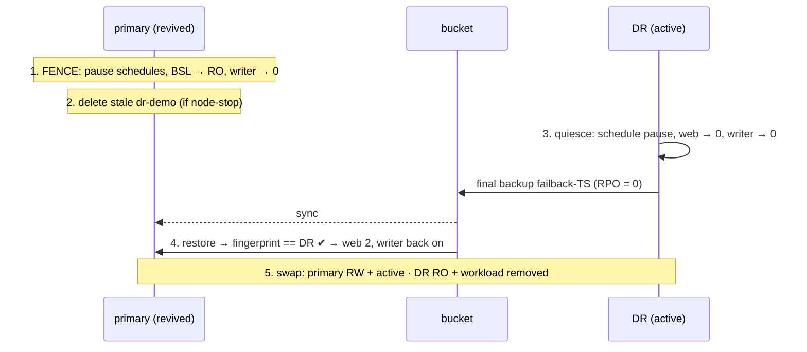
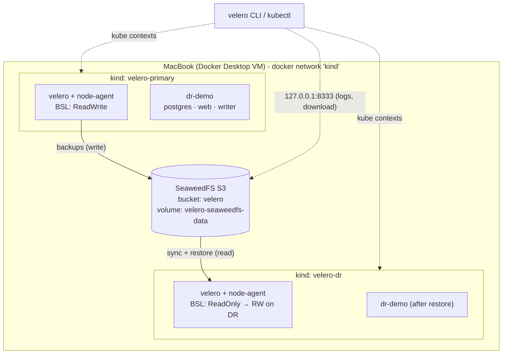
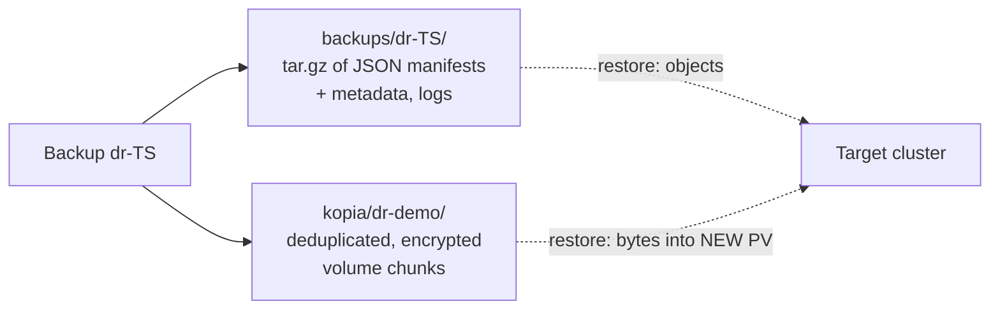

# Velero DR Lab: Demo Flows Explained

**What happens to the demo app at every step, what Velero does underneath, and how to show it to an audience.**

Companion to the [main README](../README.md). Script names refer to the lab repository.

---

## 0. How to use this document

| If you want to… | Read |
|---|---|
| Understand the app you're protecting | §1 |
| Understand what a backup and a restore do internally | §2, §3 |
| Set up your screen before presenting | §4 |
| Run a specific flow and know what to say | §5 |
| Draw it on a whiteboard or slides | §6 |
| Prepare for audience questions | §7 |

New illustration tooling in this version:

| Script | Purpose |
|---|---|
| `demo/watch.sh primary\|dr` | Live dashboard for one cluster. Shows whether it is up, its BSL mode, its newest backups and restores, the demo pods with their node and init containers, PVC→PV, and the orders table with row count, newest id and data age. Run one per pane. |
| `demo/presenter.sh` | tmux layout: primary dashboard, DR dashboard and a driver shell |
| `demo/live-writes.sh on\|off` | Turns on simulated traffic: the `order-writer` Deployment inserts one row per second. This makes data loss (RPO) **visible** in Flow 2. |
| `demo/inspect-backup.sh [name]` | Opens a backup so the audience can see the bucket objects, the resource tarball, a captured manifest and the Kopia repository |

---

## 1. Anatomy of the demo app

Namespace `dr-demo` (`k8s/demo-app.yaml`). It was chosen to contain every kind of thing a real application has: state, configuration, secrets, networking and traffic.



| Object | Kind of thing | What Velero does with it | Why it's in the demo |
|---|---|---|---|
| `Namespace dr-demo` | Container | Saved as JSON. Re-created first on restore | Lets you show "the whole namespace was deleted" |
| `Secret postgres` | Credentials | Saved as JSON (base64 data) | Shows that Secrets travel. The bucket therefore holds secrets and needs protecting |
| `StatefulSet postgres` + pod `postgres-0` | Stateful workload | Saved as JSON. **Its pod annotations drive Velero:** the `backup-volumes` opt-in and a pre-backup `CHECKPOINT` hook | The thing whose *data* must survive |
| `PVC data-postgres-0` → `PV` | Persistent data | PVC and PV saved as JSON. The **volume contents** go to the Kopia repository through File System Backup (FSB) | Proves data, not just YAML, comes back |
| `ConfigMap web-content` + `Deployment web` | Stateless app and config | Saved as JSON. ConfigMap-mounted volumes are **not** sent to FSB, because they are rebuilt from the ConfigMap | Shows config restore; used for the drift-repair demo in Flow 4c |
| `Deployment order-writer` | Simulated users | Saved as JSON, **including its replica count** | Shows lost writes (RPO) and "service resumed" after DR |
| Services | Networking | Saved as JSON. ClusterIP is reassigned on restore | Shows that nothing needs re-wiring after a restore |

### Postgres details that matter

- `PGDATA=/var/lib/postgresql/data/pgdata` is a **subdirectory** of the mount. During restore Velero writes a `.velero/` marker directory at the **volume root**. Keeping PGDATA one level down stops Postgres' `initdb` checks from tripping over that marker or over `lost+found`.
- Pod annotations on `postgres-0`:

  ```yaml
  backup.velero.io/backup-volumes: data                 # FSB this volume (redundant with opt-out install, explicit for teaching)
  pre.hook.backup.velero.io/container: postgres
  pre.hook.backup.velero.io/command: '["/bin/sh","-c","psql -U postgres -d demo -c CHECKPOINT"]'
  pre.hook.backup.velero.io/on-error: Fail              # no hook → no backup (fail-closed)
  pre.hook.backup.velero.io/timeout: 30s
  ```

### How the lab proves data came back

| Proof | SQL | Used in |
|---|---|---|
| **Fingerprint** | `count(*) \|\| ':' \|\| md5(string_agg(id\|item\|created_at ORDER BY id))`, giving for example `1250:9b1e…` | Flows 1, 2 (quiet), 4, 5. One changed byte in any row changes the hash |
| **Row-hash prefix** | One line per row, `id\|md5(item\|created_at)`, saved to `.state/*.txt` | Flow 2 (live). The restored table must be an exact **prefix** of the primary's last state. The missing tail is the data loss |
| **Writer's server stamp** | `order-writer` writes `live@<pg_postmaster_start_time>` | Flow 2 (live). Rows from the old site and the new site carry **different stamps**, so the cut-over point is visible in the data itself |

---

## 2. What a backup actually does

`velero backup create X --include-namespaces dr-demo --wait`



**Where everything ends up**

| Thing | Location in bucket | Format |
|---|---|---|
| Every Kubernetes object in scope | `backups/X/X.tar.gz` → `resources/<group.resource>/namespaces/dr-demo/<name>.json` (cluster-scoped objects under `…/cluster/…`) | Plain JSON, readable |
| Backup metadata | `backups/X/velero-backup.json`, plus `*-logs.gz`, `*-resource-list.json.gz`, `*-podvolumebackups.json.gz` and others | JSON or gzip |
| Postgres volume bytes | `kopia/dr-demo/…` | Content-addressed, deduplicated, encrypted blobs. One repository per namespace, shared across backups |

**Two things to say aloud:**

1. **The backup has two halves.** Manifests go in a tarball you can open and read. Volume data goes in a deduplicated repository you can't read directly. A second backup uploads only changed chunks.
2. **FSB copies a live filesystem.** It is not a point-in-time snapshot. The `CHECKPOINT` hook narrows the inconsistency window, and Postgres' own crash recovery covers what's left. That's acceptable for a demo; production databases should use the database's own point-in-time recovery.

Run `demo/inspect-backup.sh` to **show** both halves (§5, Flow 0).

---

## 3. What a restore actually does

`velero restore create R --from-backup X --wait`



**What the audience will see in the watch pane, in order:**

1. The `dr-demo` namespace appears, then PVC `data-postgres-0` shows **Pending** (WaitForFirstConsumer, waiting for the pod).
2. `postgres-0` shows `Init:0/1`, and the INIT column shows **`restore-wait`**. Velero added this init container; it is not in the original YAML.
3. The PVC becomes **Bound** to a **new** PV with a different name from the original. The data is coming, but not yet.
4. `postgres-0` becomes Running/Ready. The **ORDERS TABLE** row count jumps from "postgres not answering" to the backed-up count.
5. The `web` pods are already Running before Postgres, because they don't depend on volume data. Point this out: restore order is by resource type, not application readiness.

Optional extra proof: `kubectl --context <ctx> -n dr-demo logs postgres-0 -c postgres | head`. Postgres typically reports that the database was not shut down cleanly and runs automatic recovery. That's what you'd expect after copying a live data directory.

**Restore rules to state explicitly:**

- **Additive.** Objects that already exist are skipped (`--existing-resource-policy=none`). Velero never overwrites a live volume.
- **Status is dropped.** Controllers rebuild it, and pods get new UIDs and IPs.
- **The PV is new.** Only the contents are restored. That's why the target cluster can use a different node, StorageClass or even CSI driver.

---

## 4. Presenter setup

### 4.1 Screen layout

```bash
brew install tmux          # once
./demo/presenter.sh
```

```
┌───────────────────────────────┬───────────────────────────────┐
│ watch.sh primary              │ watch.sh dr                   │
│  ▌kind-velero-primary UP      │  ▌kind-velero-dr UP [standby] │
│  BSL default Available RW     │  BSL default Available RO     │
│  LATEST BACKUPS …             │  LATEST BACKUPS … (synced)    │
│  pods / PVC / ORDERS TABLE    │  (namespace does not exist)   │
├───────────────────────────────┴───────────────────────────────┤
│ driver: ./demo/flow-2-cluster-dr.sh                           │
└───────────────────────────────────────────────────────────────┘
```

Without tmux, open three iTerm2 or Terminal panes and run the same commands. Increase the font size, because the dashboards are dense.

**Optional browser tabs:**

| Tab | How | Shows |
|---|---|---|
| SeaweedFS filer | <http://127.0.0.1:8888/buckets/velero/> | Backups appearing as folders. Proves the bucket is outside both clusters |
| The web app | `kubectl --context kind-velero-primary -n dr-demo port-forward svc/web 8080:80`, then <http://localhost:8080> | "If you can read this after a restore, ConfigMaps came back too." Re-run the port-forward against the DR context after failover |
| Writer log stream | `kubectl --context <ctx> -n dr-demo logs -f deploy/order-writer` | `id\|timestamp` per second. Stops dead at the disaster and resumes on DR with new stamps |

### 4.2 Pre-flight checklist (about 10 minutes before)

```bash
./scripts/status.sh                         # both BSLs Available; active site = primary
cat .state/active                           # must be "primary" - if "dr", run demo/flow-5-failback.sh
# Pre-warm image caches on BOTH clusters so restores aren't slowed by pulls:
DEMO_AUTO=1 ./demo/flow-4-clone-and-selective.sh   # pulls images on primary
./scripts/04-deploy-demo-app.sh dr 1 && kubectl --context kind-velero-dr delete ns dr-demo
```

Explain the second line if anyone asks: a real DR site also needs images available locally, through a registry mirror or pre-pulled images. Pulling from a public registry during an outage adds to RTO.

Reset to the starting state between rehearsals: `./scripts/reset.sh` (about 2–4 min; add `--keep-backups` to keep history). For a full rebuild: `./scripts/teardown.sh --purge && ./scripts/up.sh`.

### 4.3 Running order and timing

| # | Flow | Live time | Audience message |
|---|---|---|---|
| 0 | Open the box (`inspect-backup.sh`) | 3 min | A backup is readable manifests plus a deduplicated data repository |
| 1 | Namespace restore | 4 min | Everyday recovery: a mistake gets undone with the data intact |
| 3 | Schedules | 3 min | Schedule frequency sets RPO; TTL sets retention |
| 4 | Clone and selective | 5 min | Test DR without touching production; restores are surgical |
| 2 | **Site DR (live writes)** | 7 min | Losing a cluster has a measurable RTO and RPO |
| 5 | Failback | 5 min | Returning service is planned work, fenced, with zero data loss |

Run Flow 0 after Flow 1, so a backup exists to inspect.

---

## 5. The flows, step by step

Column guide: **Cmd** is what the script runs. **Cluster** is what changes. **Velero** is what Velero is doing. **Screen** is where to point. **Say** is a suggested line.

### Flow 0: Open the box (`demo/inspect-backup.sh`)

| Step | Cmd | Screen | Say |
|---|---|---|---|
| 1 | `aws s3 ls s3://velero/backups/<bk>/` | A list of about 8 objects | "A backup is a folder of files in an ordinary bucket. No proprietary appliance." |
| 2 | `velero backup download` + `tar -tz` | `resources/statefulsets.apps/namespaces/dr-demo/postgres.json`, `secrets/…/postgres.json` and so on | "Every object, as JSON. Readable and diffable. This is also your audit evidence." |
| 3 | `jq` on `postgres.json` | The hook and backup-volumes annotations | "The backup policy lives *on the workload*: developers own consistency." |
| 4 | `aws s3 ls s3://velero/kopia/dr-demo/` | Opaque blob names | "Volume bytes aren't in the tarball. They're chunked, deduplicated and encrypted by Kopia. A second backup uploads only changes." |

### Flow 1: "Someone deleted the namespace" (`demo/flow-1-namespace-restore.sh`)

**Start state:** primary active. `dr-demo` running with 1,000+ rows. Writer off (the script pauses it if it's on).



| Step | Cmd | Cluster | Velero | Screen (primary pane) | Say |
|---|---|---|---|---|---|
| 1 Baseline | `db_fingerprint`, `get all,pvc,cm,secret` | Nothing changes | — | ORDERS shows e.g. 1000 rows | "Write down this fingerprint. That's our truth." |
| 2 Backup | `velero backup create … --wait` | Postgres runs `CHECKPOINT` | Backup → PVB → Kopia upload → tarball | LATEST BACKUPS gains a Completed row. A PodVolumeBackup is printed with uploader `kopia` | "Hook, volume copy, manifests. Bucket first, cluster second." |
| 3 Disaster | `kubectl delete namespace dr-demo` | Finalizers run. The PVC is released and the PV deleted (reclaim `Delete`), so **the data directory on the node is gone** | — | `(namespace does not exist)` | "This isn't a scaled-down app. The disk is deleted. There's nothing to undelete locally." |
| 4 Restore | `velero restore create … --wait` | §3 sequence | Restore → PodVolumeRestore | PVC Pending → Bound (new PV name). INIT shows `restore-wait`. Rows reappear | "Same name, brand-new disk, old contents. That init container is Velero holding the database back until the bytes land." |
| 5 Verify | fingerprint compare | — | — | `data identical - FLOW 1 PASSED` | "Byte-for-byte, every row." |

**Teaching moment, optional:** run the restore again without deleting anything. The restore completes with *warnings* saying objects already exist and were skipped, and nothing changes. "Velero never rewinds live state. To roll back data you delete it first, or restore beside it." Flow 4 shows the "beside it" option.

### Flow 3: Schedules and retention (`demo/flow-3-schedules.sh`)

| Step | Cmd | Cluster | Velero | Screen | Say |
|---|---|---|---|---|---|
| 1 | `schedule create dr-demo-every-5m --schedule "*/5 * * * *" --ttl 1h` | — | Schedule CR. The controller creates `dr-demo-every-5m-<YYYYMMDDhhmmss>` backups on cron | `schedule get`, schedule spec YAML | "The schedule is a backup *template* plus a cron expression. Frequency is your RPO." |
| 2 | `backup create --from-schedule …` | Hook runs | One backup created from the template immediately | New backup labelled `velero.io/schedule-name` | "Before a risky change, take a 'last good' backup with exactly the production policy." |
| 3 | `schedule pause` / `unpause` | — | `spec.paused: true/false` | `paused=true` | "Pause during maintenance or failover. You'll see this again in Flow 5, where it's used for fencing." |
| 4 | backup summary | — | Each backup gets `status.expiration = start + TTL`. The GC controller deletes expired backups and their bucket objects on its periodic sweep (hourly by default) | EXPIRES column | "TTL × frequency = how far back you can go. Kopia maintenance reclaims space afterwards." |

Leave the schedule running before Flow 2 and the primary pane keeps gaining backups, which is good background. Delete it afterwards if you want a clean list.

### Flow 4: Clone, selective restore, drift repair (`demo/flow-4-clone-and-selective.sh`)

**4a: Clone into `dr-demo-clone`.** `--namespace-mappings dr-demo:dr-demo-clone`

- Velero rewrites the namespace on every object, and updates PV claim references. The Postgres in the clone gets its **own new PVC and PV**, filled from the backup.
- Screen: run `kubectl get pvc -A`. Two `data-postgres-0` PVCs exist, in different namespaces, bound to different PVs.
- Say: "This is how you **test DR without declaring DR**: restore beside production, run checks, delete. It's also how you hand a forensic copy to someone without touching the original."

**4b: Selective restore.** `--selector tier=frontend --include-resources deployments` into `dr-demo-web`

- Only the `web` Deployment comes back. Its pods sit in `ContainerCreating` because ConfigMap `web-content` wasn't restored.
- Say: "Filters are powerful and dangerous. A restore is only as complete as its dependencies. Test your restore *scope*, not just your backup."

**4c: Drift repair.** The script patches `web-content` with `DEFACED`, then restores ConfigMaps with `--existing-resource-policy update`.

- The default policy would *skip* the existing ConfigMap. `update` patches it back to the backed-up content.
- Screen: the `now:` and `after:` lines. With the port-forward open, refresh the page.
- Say: "This is the 'someone kubectl-edited production' fix. In a GitOps estate Argo would revert it too. Velero covers objects that *aren't* in Git."

### Flow 2: Losing the primary site (`demo/flow-2-cluster-dr.sh`)

Run it in **live mode** for maximum effect:

```bash
./demo/live-writes.sh on                  # writer: 1 insert/s on primary
DISASTER_MODE=delete ./demo/flow-2-cluster-dr.sh
```

`stop` mode is the default. It docker-stops the node containers, which is reversible and faster to recover from. `delete` really destroys the cluster and is the more honest demo.



| Step | Cmd | Cluster | Velero | Screen | Say |
|---|---|---|---|---|---|
| 1 Data | 250 `pre-dr-*` rows inserted | Primary DB grows | — | Primary ORDERS: rows climb (and keep climbing every second in live mode) | "Business is running." |
| 2 Backup | `backup create dr-<ts> --wait` | CHECKPOINT; FSB copy | Upload to bucket | Primary LATEST BACKUPS gains `dr-<ts>` | "Snapshot of the business at this moment." |
| 3 Sync | `wait_until backup_completed dr` | **Nothing on DR changes except a Backup CR appearing** | DR's BSL controller lists `backups/` in the bucket and creates the CR locally | DR pane: `dr-<ts>` **appears on its own**. Its BSL is still RO | "The standby didn't receive anything. It *discovered* the backup in the shared bucket. No connection between the clusters exists." |
| 3b Tail (live) | `sleep 20` | Writer keeps inserting | — | Primary newest_id climbs past the backup | "Every row from here on is at risk." |
| 4 Disaster | Final `max(id)`, `now()` and row hashes captured, then `kind delete cluster` | **Primary gone**: API, nodes, local disks | — | Primary pane turns **red: DOWN / UNREACHABLE** | "That's the whole site: control plane, nodes, disks. Only the bucket survives." |
| 5 Declare DR | BSL → `ReadWrite`; `restore create` | §3 sequence on DR, with **image pulls** if it wasn't pre-warmed | Restore and PodVolumeRestore on DR | DR pane: ns appears → PVC Pending → `restore-wait` → Ready → rows appear. `order-writer` restored with replicas 1, so **newest_id starts climbing again** with a **new** `live@hh:mm:ss` stamp | "Read-only until a human declares DR. That stops a standby quietly pruning or overwriting backups." |
| 6 Verify (quiet) | Fingerprint compare | — | — | `data identical` | "Everything we backed up came back." |
| 6 Verify (live) | Prefix compare, lost-rows maths | — | — | `restored rows 1..N byte-identical`, `LOST WRITES: K rows (≈ S s)`, `new writes on DR: …`, `measured RTO …` | "**This number is your real RPO.** Not the schedule on paper: the gap between the last backup and the moment of loss. And this is the RTO, including pulling images at the DR site." |
| 7 Re-protect | `schedule create dr-demo-hourly` on DR | — | Schedule on the new active site | DR LATEST BACKUPS will start filling | "The first thing you do after failing over is protect the new primary." |

**Divergence (live mode).** Restart the primary with `DISASTER_MODE=stop` and you'll see its stale database with rows N+1..M. Meanwhile DR has issued its *own* rows after N, and some ids collide with different content. The two sites now disagree about history. That's why Flow 5 is a **one-way copy**, never a merge.

**How the live-mode maths works**, in case anyone asks:
- Just before the disaster, the script records the primary's `max(id)` (M), its DB clock `now()` (t0) and a hash of every row.
- After the restore, rows on DR with `created_at < t0` can **only** have come from the backup, because the DR writer started after t0. Their max is N.
- Rows 1..N on both sides are compared hash by hash. Lost = M − N. RPO in seconds = t0 − `created_at` of row N.
- The two clusters share one clock, because both run in the same Docker Desktop VM. That's why timestamps are comparable across them.

### Flow 5: Failback (`demo/flow-5-failback.sh`)



| Step | Cluster | Screen | Say |
|---|---|---|---|
| 1 Bring back and **fence** | Primary nodes restart (or the cluster is rebuilt and Velero installed RO). Schedules paused, BSL RO, writer scaled to 0 | Primary pane goes from red to green, with the BSL showing **RO** | "A revived primary is dangerous. It still believes it's in charge. Its schedules could push stale backups, and its writer could take traffic against a stale database. Fence first, then think." |
| 2 Stale state | In `stop` mode the old `dr-demo` is still there with pre-disaster (and, in live mode, divergent) rows. The script deletes it | Primary ORDERS shows the old count, then the namespace disappears | "Restores skip existing objects, so the stale copy has to go first or the restore silently does nothing." |
| 3 Quiesce DR + final backup | Web and writer on DR scaled to 0. Final backup with no writes in flight | DR newest_id **stops** climbing, age_s starts growing | "A *planned* failback can have zero RPO because we stop writes first. Unplanned DR can't. That asymmetry is the point." |
| 4 Restore on primary | §3 sequence | Primary pane: `restore-wait`, then rows = DR's count. Writer resumes on primary | "Same procedure, opposite direction. The runbook is symmetrical." |
| 5 Swap roles | Primary BSL RW, DR BSL RO, DR namespace deleted | Panes show the original steady state | "Back to the start. Run this drill every quarter and record RTO and RPO each time." |

---

## 6. Illustrations for slides and whiteboards

### 6.1 Architecture: one slide



Say: "Three failure domains: two clusters and a bucket. In the cloud the bucket would be in another region or account."

### 6.2 What's in a backup



### 6.3 RPO and RTO on a timeline

```mermaid
gantt
  title Flow 2 (live) - what the numbers mean
  dateFormat HH:mm:ss
  axisFormat %H:%M:%S
  section Primary
  Writes captured in backup       :done,    a1, 10:00:00, 60s
  Backup dr-ts runs               :active,  a2, 10:01:00, 20s
  Writes NOT in any backup (lost) :crit,    a3, 10:01:20, 40s
  section Disaster
  Primary destroyed (t0)          :milestone, m1, 10:02:00, 0s
  section DR site
  Restore + image pull + PG recovery :active, b1, 10:02:00, 90s
  Service resumed (new writes)    :done,    b2, 10:03:30, 60s
```



- **RPO** is the red bar: from the last write captured in the backup to t0.
- **RTO** is the DR restore bar: from t0 to service resumed.
- Flow 2 prints both.

### 6.4 Site state across the whole demo

| After… | Active | Primary BSL | DR BSL | `dr-demo` on primary | `dr-demo` on DR | Writer |
|---|---|---|---|---|---|---|
| `up.sh` | primary | RW | RO | ✔ (1000 rows) | — | off |
| Flow 1 | primary | RW | RO | ✔ (restored) | — | off |
| Flow 3 | primary | RW (+5 min schedule) | RO | ✔ | — | off |
| Flow 4 | primary | RW | RO | ✔ (+ clones, then removed) | — | off |
| `live-writes on` | primary | RW | RO | ✔ | — | on (primary) |
| Flow 2 | **dr** | down | **RW** | ✖ cluster gone | ✔ restored | on (DR) |
| Flow 5 | primary | RW | RO | ✔ (from DR) | ✖ removed | on (primary) |

---

## 7. Audience Q&A crib

| Question | Answer |
|---|---|
| "Why not just use GitOps to rebuild?" | Git rebuilds *declared config*. It doesn't hold the database contents, runtime-created objects, or Secrets you (rightly) keep out of Git. Use both: Argo recreates platform and app config, Velero restores state. Decide who owns each object so they don't fight. |
| "Is the database backup consistent?" | Crash-consistent, made tighter by a `CHECKPOINT` hook. Postgres replays its WAL on start. For production, use database-native PITR, with Velero carrying the namespace around it. |
| "Why does the DR cluster run read-only?" | So it can't create, overwrite or garbage-collect backups in the shared bucket until a human declares DR. It also prevents split-brain writes. Velero's migration guide recommends ReadOnly locations on restore targets. |
| "What sets the RPO?" | Schedule frequency, plus how long a backup takes. Flow 2 live mode measures the real value. |
| "What dominates the RTO?" | Image pulls at the DR site, the volume download, then database recovery. Pre-pulled images or a local registry mirror, smaller volumes and parallel restores reduce it. |
| "Can it restore into a different cluster version or StorageClass?" | Same or newer Kubernetes only, never older. A different StorageClass works through the change-storage-class ConfigMap, because FSB restores into whatever new PV gets provisioned. |
| "Where would this run in production on OpenShift?" | OADP: the same Velero engine, installed by an operator, typically with CSI snapshots plus the data mover on ODF instead of FSB. |
| "Is the bucket a single point of failure?" | Yes, so treat it as tier 0: versioning, object-lock (WORM), cross-region replication, a separate account and least-privilege keys. In this lab it's a Docker volume. Say so. |
| "Are Secrets encrypted in the backup?" | The tarball holds Kubernetes Secrets as they are in the API (base64). Kopia volume data is encrypted in its repository. Protect the bucket accordingly: server-side encryption and access policy. |
